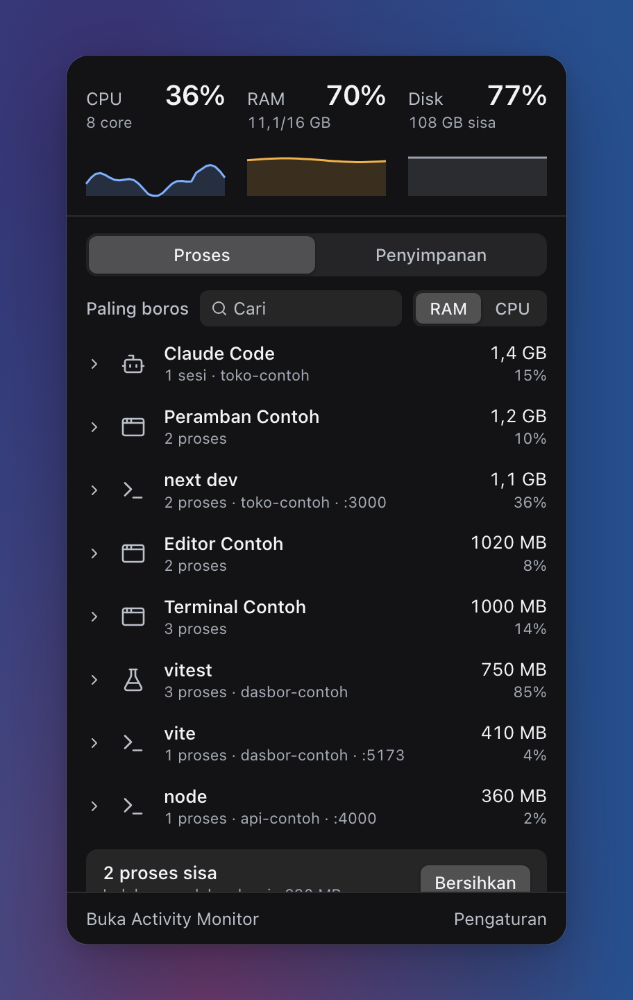
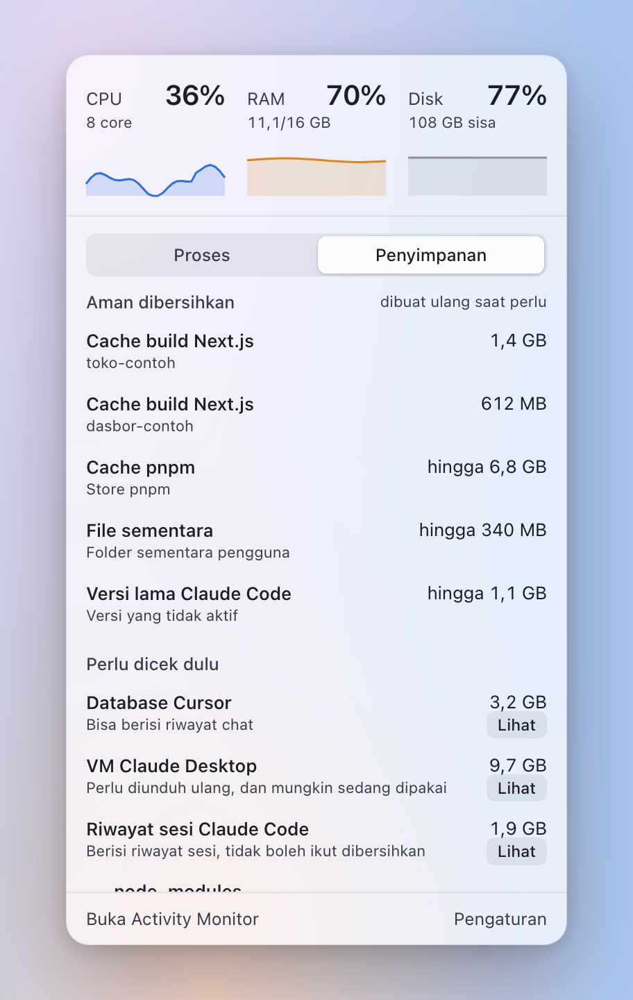
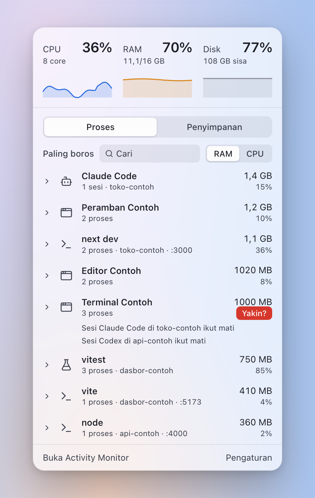

<p align="center">
  
</p>

<h1 align="center">Pantau</h1>

<p align="center">
  See what is using your Mac, and stop it or clean it up with one click. A macOS menu bar app for CPU, memory and disk.
</p>

<p align="center">
  <a href="https://pantau-app.vercel.app"></a>
  <a href="https://github.com/fizipan/pantau/releases/latest"></a>
  <a href="LICENSE"></a>
  
</p>

<p align="center">English · <a href="README.id.md">Bahasa Indonesia</a></p>

<p align="center">
  
  
</p>

<p align="center">
  
</p>

<p align="center"><sub>All screenshots use example data.</sub></p>

```bash
brew install --cask fizipan/tap/pantau
```

When a laptop with 8 GB of RAM runs an AI agent, a dev server and a test run at once, it gets slow and it is hard to tell why. Pantau sits in the menu bar, names what is using the CPU, memory and disk, and lets you stop a process or clear a cache from the same panel. It is for one person on one Mac. It needs no helper with elevated rights, makes no network connection and has no account.

**The interface is in Indonesian only for now.** There is no English translation yet.

## Early release

Read this before you click anything. Most of what is tested so far is tested at the code level. These parts have **not** been fully checked in the real app:

- Kill, including the confirmation for an AI session
- Clicking the notification banners
- The settings window and start at login
- Cleaning pnpm, temporary files and old Claude Code versions on real data

Pantau can stop processes and delete cache folders. Read the confirmation before you click, and don't run it with unsaved work in the processes it lists. Cleaning `.next` caches and opening the panel have been tried for real.

## What it does

**Proses tab**
- Processes are grouped by app (`.app` bundle) or by developer tool and project: `claude`, `vitest`, `jest`, `playwright`, `next`, `vite`, `tsx`, `bun`, `codex`, `cursor-agent`. Vitest workers sit under the Vitest row. Anything else is grouped by name and project, so `node` in two projects becomes two rows. The project name comes from the nearest folder with a `.git` or `package.json`.
- Memory is `phys_footprint`, the figure Activity Monitor shows. CPU runs from 0 to 100%.
- Listening TCP ports show on the row and can be searched (`:3000`).
- Kill takes one click for a single process. A group, an AI session, or a target that holds an AI session asks again first (`Yakin?`), with a warning naming the sessions that would die. The signal is `SIGTERM`. If the process is still alive after 5 seconds, a **Paksa** button (`SIGKILL`) appears.
- Leftover processes (the parent is gone, a test or dev tool, no port) are listed with their command, project and age. You pick and confirm.
- A banner appears when memory pressure is not normal, with swap.

**Penyimpanan tab**
- Cleaned in place: `.next` caches per project, the pnpm store (`pnpm store prune`), temporary files older than 3 days that no process has open, and old Claude Code versions (not the active one, not the newest, and not one a session is running). A version a session is using is skipped and counted. If the list of open files can't be read, no version is deleted.
- View only (opens Finder): the Cursor database, the Claude Desktop VM, Claude Code session history, `node_modules`, leftover Docker installs. Pantau never deletes `~/.claude/projects` or `state.vscdb`.
- A list of files of 100 MB or more that changed in the last 7 days.
- After a cleanup it shows the disk space that actually came back, and re-measures only that item.
- Measuring and scanning run only while the panel is open and stop when it closes. Results are kept, and the next opening starts with whatever has waited longest. The first scan can take a few minutes.

**Also:** a 60-second graph, notifications (memory pressure for more than 30 seconds, disk under 20 GB, 15 minutes between alerts of the same kind), a global shortcut (Ctrl+Option+M by default), a settings window, and a light and dark theme that follows macOS.

## Install

```bash
brew install --cask fizipan/tap/pantau
```

You need [Homebrew](https://brew.sh) and an **Apple Silicon** Mac. The cask is `depends_on arch: :arm64`. Upgrade with `brew upgrade --cask pantau` and remove it with `brew uninstall --cask pantau`. Adding `--zap` also deletes the app's local data.

**The app is not notarized by Apple.** It is signed ad hoc, so the cask removes the download quarantine flag to let macOS open it. If you would rather not allow that, build it from source. macOS may ask for folder access (Documents, Downloads) again after an upgrade, because an ad hoc signature changes with each build.

You can also download the DMG from [Releases](https://github.com/fizipan/pantau/releases). macOS blocks its first open, so go to System Settings, then Privacy & Security, and choose **Open Anyway**.

Install it into `/Applications` before you turn on start at login: the login item points at wherever the app was when you switched it on. If you move the app later, turn it off and on again.

### Permissions

- **Notifications:** macOS asks when the first notification is sent.
- **Documents and Downloads:** reading `~/Documents` can show a permission dialog. If it is refused, the `.next` and `node_modules` rows in that folder can't be found, and the Penyimpanan tab says "Butuh izin untuk membaca Documents" above the list. The button opens Files and Folders in System Settings.
- **Start at login:** installed as a LaunchAgent (`~/Library/LaunchAgents/Pantau.plist`) from the settings window.

## Privacy

Pantau makes **no network connections** and has **no telemetry or analytics**. The webview's content security policy allows none. Nothing leaves your Mac.

- Its own settings and measurement cache live in `~/Library/Application Support/local.toolslab.pantau`.
- It reads the process list, listening ports and open files with the system's own tools, as you, with no elevated rights.
- It only cleans registered locations, and only after a click. It never deletes chat history or `state.vscdb`.

## Limits

- Processes owned by root or another user show without numbers and without a Kill button. Pantau installs no privileged helper, so macOS doesn't give it their data. They only appear through search.
- The owner shown for a file in the "Baru masuk atau berubah" list is a guess from its folder. macOS generally doesn't record which app made a file, and Pantau doesn't claim "downloaded by AI".
- Temporary file cleanup is deliberately narrow and usually frees little. Without root, `lsof` only sees files opened by your own processes, so "not open in any process" holds only for processes Pantau can see.
- Sizes in the list are folder sizes. What a pnpm, temporary file or Claude version cleanup frees can be smaller, and the screen says "hingga" (up to).
- Notification banners are withdrawn from Notification Center after 5 minutes. While waiting, Pantau's CPU rises to about 1%; a 15-minute average measured 0.78% with the screen unlocked.
- After the panel closes, its WebContent process goes away but the WebKit GPU and Networking helpers don't leave at once. On a `measure` build, Pantau plus its helpers measured 45 to 53 MB right after closing; the GPU helper left about 75 seconds later, leaving Networking (6.6 MB) and a total of 33.6 MB. That is one run on one machine, not the default build.
- Whether App Nap widens the sampler gap while the screen is locked has not been measured. If the gap passes 10 seconds, the memory pressure notification is not sent for that stretch. With the screen open the largest gap was 2.1 seconds.
- Panel position is computed in points per screen so a 2x laptop display and a 1x external monitor don't get mixed up. That is only tested with numbers; the development machine has one screen.
- The process list shows as soon as the panel opens, with CPU as "…" until the second reading about half a second later. Memory is right from the first reading.
- Tested on one machine only (a MacBook with 8 GB of RAM, macOS 27.0.1). Notifications use the deprecated `NSUserNotification` API, which still works.
- **Intel Macs** are not supported by the release build. You can build from source, but that has not been tested on Intel.

## Build from source

You need macOS, Node.js, [pnpm](https://pnpm.io), [Rust](https://rustup.rs) and the Xcode Command Line Tools. The build is signed ad hoc, so no certificate is needed.

```bash
git clone https://github.com/fizipan/pantau.git
cd pantau
pnpm install
pnpm tauri build --bundles app
open src-tauri/target/release/bundle/macos/Pantau.app
```

Copy it to `/Applications` to keep it.

## Development

```bash
pnpm tauri dev                     # run the app
pnpm vitest run                    # frontend tests
pnpm tsc --noEmit                  # type check
cd src-tauri && cargo test         # Rust tests
cd src-tauri && cargo clippy --all-targets -- -D warnings
```

Three cargo features, all off by default:
- `measure` opens and closes the panel on a schedule to measure memory (`scripts/measure-webview.sh <pid>`).
- `notify-test` sends one low-disk notification 5 seconds after start, to try the banner and its click.
- `tick-log` writes the largest gap between system samples once a minute, to check the 10-second limit on memory pressure notifications.

Built with Tauri 2, Rust, React, TypeScript and Tailwind CSS. The website is in `site/`, built with Astro, GSAP and Lenis. Run it with `cd site && pnpm install && pnpm dev`. The design notes are in [docs/design/DESIGN.md](docs/design/DESIGN.md). See [CONTRIBUTING.md](CONTRIBUTING.md) before opening a pull request, and [SECURITY.md](SECURITY.md) to report a vulnerability.

## License

[MIT](LICENSE).
